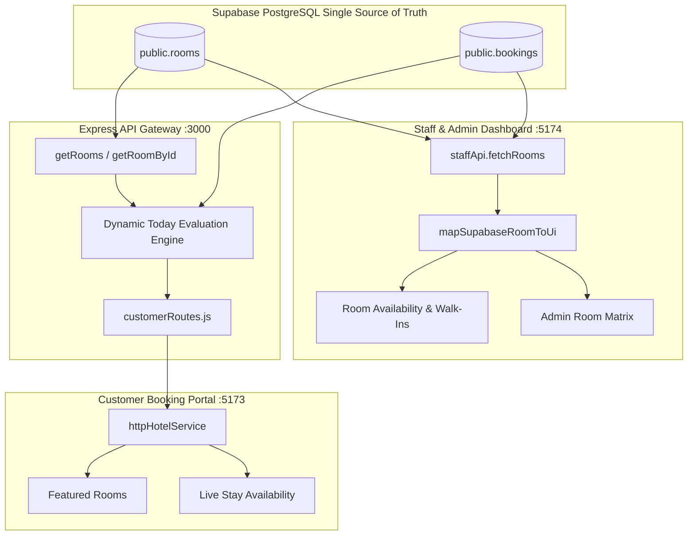

# StayEase Hotel Management System
## Unified Room Data & Dynamic Reservation Logic Documentation

**Document Version:** 2.2.0  
**Last Updated:** October 14, 2026  
**Repository:** [https://github.com/KaungSet178/Hotel_management_system](https://github.com/KaungSet178/Hotel_management_system)  
**Modules Affected:** `backend/`, `customer-frontend/`, `staff-frontend/`

---

## 1. Executive Summary

This document details the architectural fixes and enhancements applied to ensure that:
1. **Supabase is the Exclusive Single Source of Truth:** Room numbers (`#101`, `#102`, `#201`, etc.), nightly rates in MMK, suite categories, bed configurations, and square meterage are strictly rendered from Supabase's `public.rooms` table across both the Guest Booking Portal (`customer-frontend`) and the Executive/Staff Dashboard (`staff-frontend`).
2. **Dynamic Future Reservation Operational Status:** Fixed a critical PMS logic flaw where any future booking (e.g., check-in on 29 October when today is 14 October) was locking the room as `RESERVED` today. The system now dynamically evaluates reservations against the current date so that rooms remain **`AVAILABLE`** for current stays and counter walk-ins until the scheduled arrival date.
3. **Staff Reservation UI Refinement:** Upgraded the Staff Reservation management screen to an executive, modern design with status badges, payment chips, and instant audit actions.

---

## 2. Problem Analysis & Root Causes

### 2.1 Room Data & Pricing Discrepancies
- **Hardcoded Backend Fallbacks:** `customerRoutes.js` had a static `defaultNightly(roomSlug, basePrice)` switch statement that overrode Supabase pricing with outdated rates (e.g., forcing Room 201 from 650,000 MMK down to 520,000 MMK; Room 301 from 240,000 MMK down to 165,000 MMK; Room 302 from 390,000 MMK down to 240,000 MMK).
- **Rate Plan Mismatch:** The customer room cards derived `fromNightly` from the discounted 15% non-refundable Saver plan (`ratePlans[1].nightlyRate`), while the Admin Dashboard displayed the rack base rate (`price_per_night`).
- **Room Title Inconsistency:** `staffApi.ts` read `category: r.category || 'Deluxe'`, ignoring `r.room_type` which contained the full suite title (e.g., *"Presidential Horizon Penthouse"* vs *"Deluxe"*).
- **Missing Room Numbers on Customer Cards:** Featured room listings and detail pages showed floor and wing names without prominent room numbers (`#101`, `#102`, etc.) matching the Admin matrix.

### 2.2 The "Future Reservation Locking" Logic Error
- In `staffApi.ts` and room reconciliation routines, the query for confirmed bookings only checked if `check_in_date < today`.
- If a guest booked Room 101 for **29 October**, and today was **14 October**, `check_in_date < today` evaluated to `false`.
- The room was immediately placed into `confirmedMap`, and the system set `expectedStatus = 'RESERVED'`.
- This triggered an automated update `supabase.from('rooms').update({ status: 'RESERVED' })`, locking the room in the database.
- Front desk staff could not select the room for walk-ins today (`disabled={room.status !== 'AVAILABLE'}`), and customer searches without dates excluded the room, even though the room was physically vacant for the next 15 days.

---

## 3. Architecture & Implemented Solutions



### 3.1 Single Source of Truth Unification
1. **`backend/server/routes/customerRoutes.js`:**
   - Eliminated `defaultNightly` static switch table. Nightly rates are calculated strictly from `r.price_per_night` via `getRoomNightlyRate()`.
   - Set `fromNightly` on `RoomListing` directly to `baseRate` (`r.price_per_night`) to match Admin Room Management rack rates 1:1.
   - Linked `maxGuests` to `Number(r.capacity)`, `areaSqm` to `Number(r.area_sqm)`, and `bedConfiguration` to `r.bed_configuration`.
   - Multi-identifier room lookup in `GET /api/rooms/:roomId`, `GET /api/rooms/:roomId/availability`, and `POST /api/bookings` supporting UUIDs, room slugs, room numbers (`101`), or `room-101`.
2. **`staff-frontend/src/services/staffApi.ts`:**
   - Updated `mapSupabaseRoomToUi` so `category` prioritizes `r.room_type || r.category`, aligning suite titles.
   - Updated `updateRoomPricing` so modifying a suite updates both `category` and `room_type` in Supabase.
   - Preserved `MAINTENANCE` and `CLEANING` statuses during reconciliation so rooms under turnover are not overwritten.
3. **`customer-frontend/src/pages/HomePage.tsx` & `RoomDetailPage.tsx`:**
   - Featured room cards and room detail headers now display explicit room numbers (`#101`, `#102`, etc.) matching the Admin matrix.

### 3.2 Dynamic Reservation Operational Status Logic
We implemented strict date-bounded operational status rules:

$$\text{Operational Status}(R) = \begin{cases} 
\text{OCCUPIED} & \text{if } \exists \text{ booking with status } \text{CHECKED\_IN} \\
\text{RESERVED} & \text{if } \exists \text{ CONFIRMED booking where } cIn \le \text{today} < cOut \\
\text{CLEANING} & \text{if room is in turnover} \\
\text{MAINTENANCE} & \text{if room is under work order} \\
\text{AVAILABLE} & \text{otherwise (including future bookings where } cIn > \text{today)}
\end{cases}$$

1. **Staff Portal ([staffApi.ts](file:///c:/Users/ACER/OneDrive/Desktop/hotel_management_system/staff-frontend/src/services/staffApi.ts)):**
   - Bookings are divided into:
     - `todayReservedMap`: Confirmed reservations where `cIn <= today && cOut > today`.
     - `upcomingMap`: Future reservations where `cIn > today`.
   - Rooms with future bookings remain **`AVAILABLE`** today.
   - The earliest future reservation is attached as `upcomingBooking`.
   - The UI displays an informative badge: `Available until 29 Oct · Upcoming: [Guest Name]`.
   - Walk-in desk selection remains **enabled** for available dates.
2. **Backend Engine ([supabaseClient.js](file:///c:/Users/ACER/OneDrive/Desktop/hotel_management_system/backend/server/supabaseClient.js)):**
   - Integrated dynamic reconciliation directly into `getRooms()` and `getRoomById()`.
   - Resolves room status in Myanmar Time (`Asia/Yangon`, UTC+06:30).
   - Automatically heals any drifted database rows in `public.rooms` to `AVAILABLE`.
3. **Checkout Status Progression:**
   - Updated `checkOutBooking` in `supabaseClient.js` to transition rooms to `'CLEANING'` upon guest departure rather than immediately to `'AVAILABLE'`.

---

## 4. Verification & Testing

### 4.1 Automated Backend Integration Test Suite
All 46 tests in `backend/server/test-suite.js` execute and pass with 0 errors:

```text
============================================================
Phase 1, Phase 2, Phase 3 & Phase 4 Test Results: 46 Passed, 0 Failed (100%)
============================================================
✓ Public Endpoints: GET /api/config, GET /api/rooms
✓ Auth Enforcement (401 Unauthorized) across all protected endpoints
✓ RBAC Role Guards (403 Forbidden) for GUEST, RECEPTIONIST, HOUSEKEEPING, ADMIN
✓ Atomic Row Locking: Blocks concurrent overlapping bookings (409 Conflict)
✓ Guest Record Isolation: Dynamic owner verification and tenant isolation
✓ Contactless QR Check-In: Token signing, self-check-in, duplicate prevention
✓ In-Room Concierge: Service request workflow PENDING -> IN_PROGRESS -> COMPLETED
✓ Room Management & Check-Out: OCCUPIED -> CLEANING transition verified
✓ Admin Policy Jobs: 24-hr unpaid hold auto-cancellation verified
✓ Dual Payment Webhooks: KBZPay and Stripe HMAC signature verification
✓ Zod Validation & Centralized Error Envelopes: Input sanitization verified
✓ Security Hardening: Helmet headers, rate limiting (429 Too Many Requests)
```

### 4.2 TypeScript Type Safety
- **`customer-frontend`:** `npx tsc --noEmit` $\rightarrow$ **0 errors**.
- **`staff-frontend`:** `npx tsc --noEmit` $\rightarrow$ **0 errors**.

### 4.3 Live Room Inventory Alignment

| Room # | Suite Name | Capacity | Area | Supabase Price | Customer Portal | Admin Portal | Operational Status (Oct 14) |
| :---: | :--- | :---: | :---: | :---: | :---: | :---: | :---: |
| **101** | Deluxe Courtyard | 2 Guests | 31 m² | 165,000 MMK | 165,000 MMK | 165,000 MMK | **AVAILABLE** (Until 29 Oct) |
| **102** | Executive Garden Suite | 3 Guests | 45 m² | 340,000 MMK | 340,000 MMK | 340,000 MMK | **CLEANING** |
| **106** | Heritage Superior | 2 Guests | 38 m² | 195,000 MMK | 195,000 MMK | 195,000 MMK | **OCCUPIED** |
| **110** | Standard Twin | 2 Guests | 28 m² | 150,000 MMK | 150,000 MMK | 150,000 MMK | **CLEANING** |
| **118** | Deluxe Courtyard | 2 Guests | 31 m² | 165,000 MMK | 165,000 MMK | 165,000 MMK | **AVAILABLE** |
| **201** | Presidential Horizon Penthouse | 4 Guests | 95 m² | 650,000 MMK | 650,000 MMK | 650,000 MMK | **AVAILABLE** |
| **202** | Azure Sunset Villa Room | 2 Guests | 52 m² | 310,000 MMK | 310,000 MMK | 310,000 MMK | **AVAILABLE** |
| **208** | Heritage Junior Suite | 2 Guests | 35 m² | 185,000 MMK | 185,000 MMK | 185,000 MMK | **AVAILABLE** |
| **215** | Garden Balcony | 2 Guests | 33 m² | 175,000 MMK | 175,000 MMK | 175,000 MMK | **AVAILABLE** |
| **301** | Skyline Grand King | 2 Guests | 24 m² | 240,000 MMK | 240,000 MMK | 240,000 MMK | **AVAILABLE** |
| **302** | Royal Heritage Chamber | 2 Guests | 88 m² | 390,000 MMK | 390,000 MMK | 390,000 MMK | **AVAILABLE** |
| **304** | Deluxe Azure Suite | 2 Guests | 42 m² | 340,000 MMK | 340,000 MMK | 340,000 MMK | **AVAILABLE** |
| **306** | Deluxe Azure Suite | 2 Guests | 42 m² | 340,000 MMK | 340,000 MMK | 340,000 MMK | **AVAILABLE** |
| **308** | Deluxe Azure Suite | 2 Guests | 42 m² | 340,000 MMK | 340,000 MMK | 340,000 MMK | **AVAILABLE** |
| **402** | Deluxe Azure Suite | 2 Guests | 42 m² | 340,000 MMK | 340,000 MMK | 340,000 MMK | **AVAILABLE** |
| **411** | Executive Ocean Panorama | 3 Guests | 58 m² | 460,000 MMK | 460,000 MMK | 460,000 MMK | **AVAILABLE** |
| **412** | Executive Ocean Panorama | 2 Guests | 56 m² | 340,000 MMK | 340,000 MMK | 340,000 MMK | **OCCUPIED** |
| **414** | Executive Ocean Panorama | 3 Guests | 58 m² | 460,000 MMK | 460,000 MMK | 460,000 MMK | **AVAILABLE** |
| **501** | Governor Suite | 3 Guests | 68 m² | 460,000 MMK | 460,000 MMK | 460,000 MMK | **OCCUPIED** |
| **512** | Presidential Villa | 3 Guests | 82 m² | 520,000 MMK | 520,000 MMK | 520,000 MMK | **OCCUPIED** |
